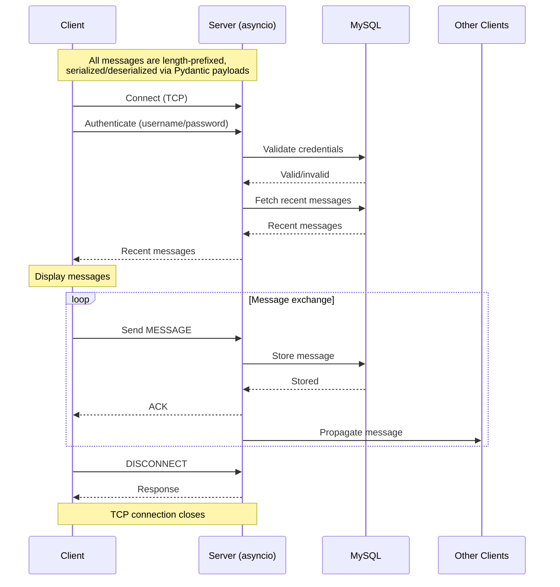

# Chat App

A chat application written in Python using async TCP networking and MySQL.

## Overview

There are three main parts to this chat application:

- **Protocol**: The protocol defines how messages are formatted and transmitted between the client and server.
- **Server**: The server handles incoming connections from clients, processes messages, and manages user sessions. It uses async TCP networking to handle multiple clients concurrently.
- **Client**: The client connects to the server, sends messages, and receives messages from other users. It provides a user interface for interacting with the chat application.



## Running the Server

### Docker Compose

To run the chat application using Docker Compose, follow these steps:

1. Make sure you have Docker and Docker Compose installed on your machine.
2. Clone the repository to your local machine.
```bash
git clone https://github.com/tathyagarg/chat.git
cd chat
```
3. Create a `.env` file in the root directory of the project and add the variables found in the `.env.example` file. Update the values as needed for your environment.
4. Start the application using Docker Compose:
```bash
docker compose up -d
```

### Manual Setup

To run the server manually, follow these steps:

1. Make sure you have Python 3.13 or higher installed on your machine.
2. Clone the repository to your local machine.
```bash
git clone https://github.com/tathyagarg/chat.git
cd chat
```
3. Install the required dependencies:
```bash
pip install -r server/requirements.txt
```
4. Set up the MySQL database:
   - Install MySQL on your machine if you haven't already.
   - Create a new database for the chat application.
   - Create a `.env` file in the `server` or `chat` directory and add the variables found in the `.env.example` file. Update the values as needed for your environment.
5. Run the server (from the project root):
```bash
python -m server
```

> [!NOTE]
> To expose the server, specify `-H 0.0.0.0` and `-P <port>` when running the server. The default port is 12345.

## Running the Client

To run the client, follow these steps:

1. Make sure you have Python 3.13 or higher installed on your machine.
2. Clone the repository to your local machine.
```bash
git clone https://github.com/tathyagarg/chat.git
cd chat
```
3. Install the required dependencies:
```bash
pip install -r client/requirements.txt
```
4. Run the client (from the project root):
```bash
python -m client
```
5. When prompted, enter the server's host and port to connect to the chat server.
6. Authenticate with a username and password. It will create a new user if the username does not exist.
7. Use `Ctrl+C` to exit the client.

# Documentation

Refer to the `docs/` directory for detailed documentation on the protocol, server, and client components of the chat application.

# License

This project is licensed under the AGPL-3.0 License. See the `LICENSE` file for more information.
