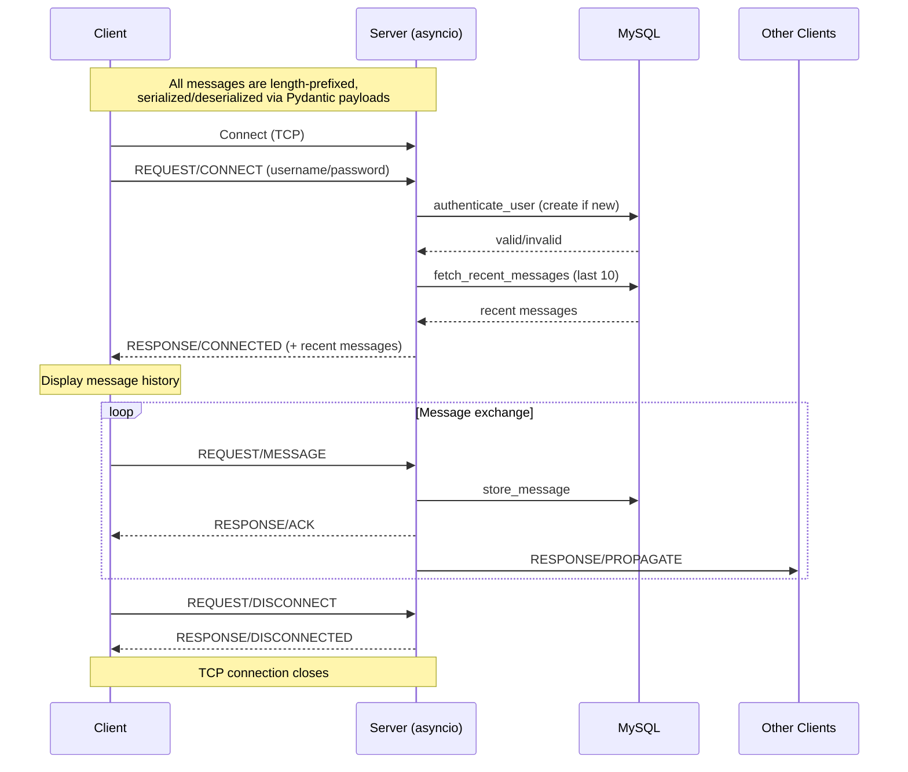

# Architecture Overview

`chat` is a terminal-based chat application built around a custom length-prefixed TCP protocol, an `asyncio` server, MySQL for persistence, and a `rich`-powered terminal client.

## Components

| Package | Role |
|---|---|
| `shared/` | Defines the wire protocol (`Message`, `MessageType`, `MessageKind`, `Payload` subclasses) used by both client and server. See [`PROTOCOL.md`](./PROTOCOL.md). |
| `server/` | Async TCP server: accepts connections, authenticates users, stores/broadcasts messages, runs DB migrations. See [`SERVER.md`](./SERVER.md). |
| `client/` | Terminal client: connects to a server, authenticates, and provides an interactive send/receive loop. See [`CLIENT.md`](./CLIENT.md). |
| `migrations/` | Plain `.sql` files applied in order by the server on startup (see `server/database.py:execute_migrations`). |

## Request Flow

## Data Model

Two tables, created by `migrations/0001_init.sql` and `migrations/0002_messages.sql`:

- **`users`**: `id`, `username` (unique), `password` (bcrypt hash).
- **`messages`**: `id`, `sender_id` (FK -> `users.id`, cascades on delete), `content`
  (max 1024 chars), `timestamp` (defaults to current time).

The server tracks which migrations have run in an auto-created `migrations` table keyed by the migration's relative file path (e.g. `migrations/0001_init.sql`), so re-running the server never re-applies a migration.

## Running It

- **Docker Compose** (recommended): brings up MySQL and the server together. Copy
  `.env.example` to `.env`, fill in the values, then `docker compose up -d`.
- **Manual**: Python 3.13+, `pip install -r server/requirements.txt` /
  `pip install -r client/requirements.txt`, a running MySQL instance, then
  `python -m server` and `python -m client` from the project root.

The server defaults to binding `localhost:12345`; pass `-H 0.0.0.0` to accept
external connections. Server logs are written to `logs/server.log` by default
(`--logfile`/`-L` to change) and also to stdout unless `--no-debug` is passed.
